# Educação Continuada Gamificada

## Descrição do Estudo de Caso

Uma determinada plataforma vende cursos online e EAD no modelo de assinaturas. O
aluno paga um valor mensal e tem acesso a um conjunto de cursos para assinatura
básica. A cada curso terminado e com média acima de 7,0, o aluno tem direito a
realização de mais 3 cursos. O aluno que escrever mais tópicos no fórum e ajudar outros
participantes com seus comentários, ganha um curso no final do mês. Quando o aluno
conquistar 12 cursos, seu plano de assinatura passa a ser “Premium” e ele passa a
receber voucher para participar de projetos reais, durante os cursos, e receber 3 moedas,
que podem ser convertidas em conhecimento (novos cursos), acumular ou receber por
criptomoeda.

## User Stories (US)

* **US1 (por Pedro Henrique Santana):** COMO Aluno do nível básico, QUERO que minha assinatura seja alterada para
  “Premium” automaticamente quando conquistar os 12 cursos PARA ter acesso ao recebimento dos vouchers e moedas.
* **US2 (por Gabriel Pelincel Ramalho):** COMO Aluno do nível Premium, QUERO usar minhas moedas PARA comprar novos
  cursos.

### US Escolhida

A User Story escolhida para o detalhamento BDD e TDD foi a **US1** (elaborada por Pedro Henrique Santana):

> *COMO Aluno do nível básico, QUERO que minha assinatura seja alterada para “Premium” automaticamente quando conquistar
os 12 cursos PARA ter acesso ao recebimento dos vouchers e moedas.*

---

## BDD - Scenarios (Critérios de Aceitação) e Evidências TDD

### Cenário 1: Receber moedas como Premium

**Redigido por:** Pedro Henrique Santana

* **Dado** que o aluno possui 11 cursos conquistados
* **E** possui assinatura básica
* **Quando** conquistar mais 1 curso
* **Então** terá sua assinatura alterada
* **E** receber 3 moedas

#### 🔴🟢🔵 Evidências TDD (RGB) - Cenário 1

* **Teste Unitário:**

````
@Test
    public void deveMudarParaPremiumEGanharTresMoedasAoAtingirDozeCursos() {
        Aluno aluno = new Aluno();
        aluno.setAssinatura("Básica");
        aluno.setCursosConquistados(11);
        aluno.setMoedas(0);

        aluno.conquistarCurso();

        assertEquals(12, aluno.getCursosConquistados(), "Deve contabilizar o 12º curso");
        assertEquals("Premium", aluno.getAssinatura(), "A assinatura deve mudar para Premium");
        assertEquals(3, aluno.getMoedas(), "O aluno deve ganhar 3 moedas");
    }
````

* **RED (Teste Falhando):**
  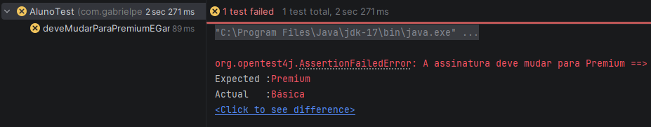

* **GREEN (Teste Passando):**
  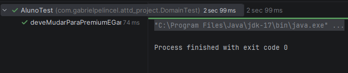

* **BLUE (Refatoração e 100% de Cobertura):**
  Teste Refatorado para maior cobertura:

```
@Test
    public void deveMudarParaPremiumEGanharTresMoedasAoAtingirDozeCursos() {
        Aluno aluno = new Aluno();
        aluno.setAssinatura("Básica");
        aluno.setCursosConquistados(10);
        aluno.setMoedas(0);

        aluno.conquistarCurso();
        assertEquals(11, aluno.getCursosConquistados(), "Deve contabilizar o 11º curso");
        assertEquals("Básica", aluno.getAssinatura(), "Deve continuar com assinatura Básica");
        assertEquals(0, aluno.getMoedas(), "Não deve ganhar moedas ainda");

        aluno.conquistarCurso();
        assertEquals(12, aluno.getCursosConquistados(), "Deve contabilizar o 12º curso");
        assertEquals("Premium", aluno.getAssinatura(), "A assinatura deve mudar para Premium");
        assertEquals(3, aluno.getMoedas(), "O aluno deve ganhar 3 moedas");

        aluno.conquistarCurso();
        assertEquals(13, aluno.getCursosConquistados(), "Deve contabilizar o 13º curso");
        assertEquals("Premium", aluno.getAssinatura(), "Deve se manter Premium");
        assertEquals(3, aluno.getMoedas(), "Não deve ganhar moedas duplicadas ao passar de 12 cursos");
    }
```

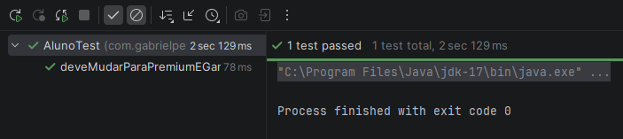
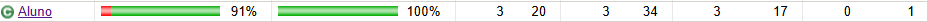

---

### Cenário 2: Tornar-se Premium ao completar cursos

**Redigido por:** Pedro Henrique Santana

* **Dado** que o aluno possui 11 cursos conquistados
* **E** possui assinatura básica
* **Quando** conquistar mais 1 curso
* **Então** deverá possuir 12 cursos
* **E** sua assinatura deverá ser alterada
* **E** deve possuir acesso ao recebimento dos voucher

#### 🔴🟢🔵 Evidências TDD (RGB) - Cenário 2

* **Teste Unitário:**

````
@Test
    public void deveAlterarAssinaturaELiberarAcessoAVouchersAoAtingirDozeCursos() {
        Aluno aluno = new Aluno();
        aluno.setAssinatura("Básica");
        aluno.setCursosConquistados(11);
        aluno.setAcessoVouchers(false);

        aluno.conquistarCurso();

        assertEquals(12, aluno.getCursosConquistados());
        assertEquals("Premium", aluno.getAssinatura());
        assertTrue(aluno.isAcessoVouchers(), "O aluno deveria ter acesso aos vouchers");
    }
````

* **RED (Teste Falhando):**
  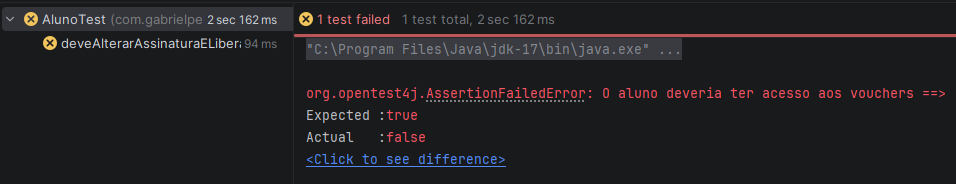

* **GREEN (Teste Passando):**
  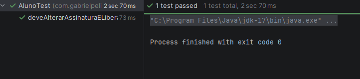

* **BLUE (Refatoração e 100% de Cobertura):**
  Teste Refatorado para maior cobertura:

```
@Test
    public void deveAlterarAssinaturaELiberarAcessoAVouchersAoAtingirDozeCursos() {
        Aluno aluno = new Aluno();
        aluno.setAssinatura("Básica");
        aluno.setCursosConquistados(10);
        aluno.setAcessoVouchers(false);

        aluno.conquistarCurso();
        assertFalse(aluno.isAcessoVouchers(), "Ainda não deve ter acesso a vouchers com 11 cursos");

        aluno.conquistarCurso();
        assertEquals(12, aluno.getCursosConquistados());
        assertEquals("Premium", aluno.getAssinatura());
        assertTrue(aluno.isAcessoVouchers(), "Deve possuir acesso ao recebimento dos voucher");

        aluno.conquistarCurso();
        assertEquals(13, aluno.getCursosConquistados());
        assertTrue(aluno.isAcessoVouchers());
    }
```

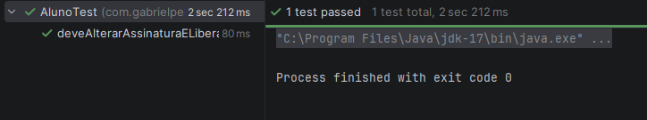
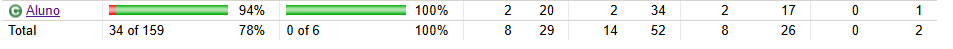
---

### Cenário 3: Receber voucher e acesso a projetos reais

**Redigido por:** Gabriel Pelincel Ramalho

* **Dado** que o aluno possui 11 cursos conquistados
* **E** possui assinatura básica
* **Quando** conquistar mais 1 curso
* **Então** terá sua assinatura alterada
* **E** receber 1 voucher
* **E** ter acesso a projetos reais, durante os cursos

#### 🔴🟢🔵 Evidências TDD (RGB) - Cenário 3

* **Teste Unitário:**

````
@Test
    public void deveReceberUmVoucherEAcessoAProjetosReaisAoTornarPremium() {
        Aluno aluno = new Aluno();
        aluno.setAssinatura("Básica");
        aluno.setCursosConquistados(11);
        aluno.setVouchers(0);

        aluno.conquistarCurso();

        assertEquals("Premium", aluno.getAssinatura(), "A assinatura deveria ser Premium");
        assertEquals(1, aluno.getVouchers(), "O aluno deveria ter recebido 1 voucher");
        assertTrue(aluno.isAcessoProjetosReais(), "O aluno deveria ter acesso a projetos reais");
    }
````

* **RED (Teste Falhando):**
  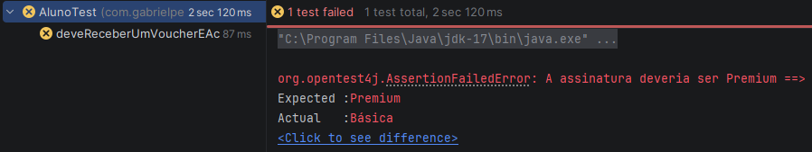


* **GREEN (Teste Passando):**
  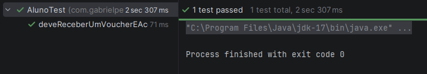


* **BLUE (Refatoração e 100% de Cobertura):**

Teste Refatorado para garantir maior cobertura:

````
@Test
    public void deveReceberUmVoucherEAcessoAProjetosReaisAoTornarPremium() {
        Aluno aluno = new Aluno();
        aluno.setAssinatura("Básica");
        aluno.setCursosConquistados(10);
        aluno.setVouchers(0);
        aluno.setMoedas(0);
        aluno.setAcessoVouchers(false);

        aluno.setAcessoProjetosReais(false);

        aluno.conquistarCurso();

        aluno.conquistarCurso();

        aluno.conquistarCurso();

        assertEquals(13, aluno.getCursosConquistados());
        assertEquals("Premium", aluno.getAssinatura());
        assertTrue(aluno.isAcessoProjetosReais());
    }
````


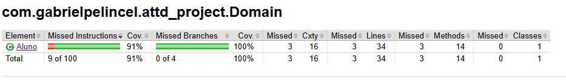
---

### Cenário 4: Resgatar voucher em projeto real

**Redigido por:** Gabriel Pelincel Ramalho

* **Dado** que o aluno possui 11 cursos conquistados
* **E** possui assinatura básica
* **Quando** conquistar mais 1 curso
* **Então** terá sua assinatura alterada
* **E** receber 1 voucher
* **E** resgatar 1 voucher em 1 projeto real

#### 🔴🟢🔵 Evidências TDD (RGB) - Cenário 4

* **Teste Unitário:**

````
@Test
    public void devePermitirResgateDeVoucherEmProjetoRealAposTornarPremium() {
        Aluno aluno = new Aluno();
        aluno.setAssinatura("Básica");
        aluno.setCursosConquistados(11);
        aluno.setVouchers(0);

        aluno.conquistarCurso();

        ProjetoReal projeto = new ProjetoReal();
        aluno.resgatarVoucher(projeto);

        assertEquals("Premium", aluno.getAssinatura());
        assertEquals(0, aluno.getVouchers(), "O voucher deveria ter sido descontado");
        assertTrue(projeto.isVoucherAplicado(), "O projeto deveria estar com o voucher aplicado");
    }
````

* **RED (Teste Falhando):**
  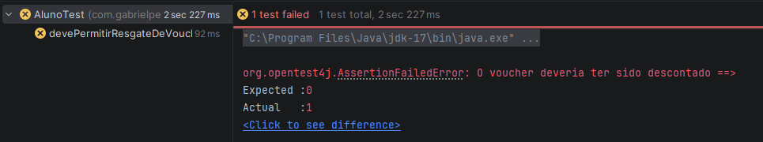


* **GREEN (Teste Passando):**
  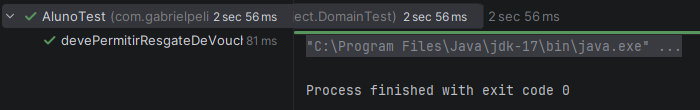


* **BLUE (Refatoração e 100% de Cobertura):**

Teste Refatorado para garantir maior cobertura:

````
@Test
    public void devePermitirResgateDeVoucherEmProjetoRealAposTornarPremium() {
        Aluno aluno = new Aluno();
        aluno.setAssinatura("Básica");
        aluno.setCursosConquistados(11);
        aluno.setVouchers(0);

        ProjetoReal projetoSemSaldo = new ProjetoReal();
        ProjetoReal projetoComSaldo = new ProjetoReal();

        aluno.resgatarVoucher(projetoSemSaldo);
        assertFalse(projetoSemSaldo.isVoucherAplicado(), "Não deve aplicar voucher se não tiver saldo");

        aluno.conquistarCurso();

        aluno.resgatarVoucher(projetoComSaldo);

        assertEquals("Premium", aluno.getAssinatura(), "A assinatura deveria ser Premium");
        assertEquals(0, aluno.getVouchers(), "O voucher deveria ter sido descontado");
        assertTrue(projetoComSaldo.isVoucherAplicado(), "O voucher deveria ter sido aplicado no projeto");
    }
````

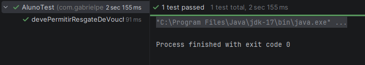
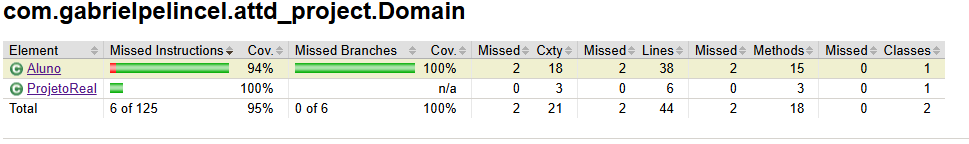

## Evidências:

* H2 rodando:<br><br>
  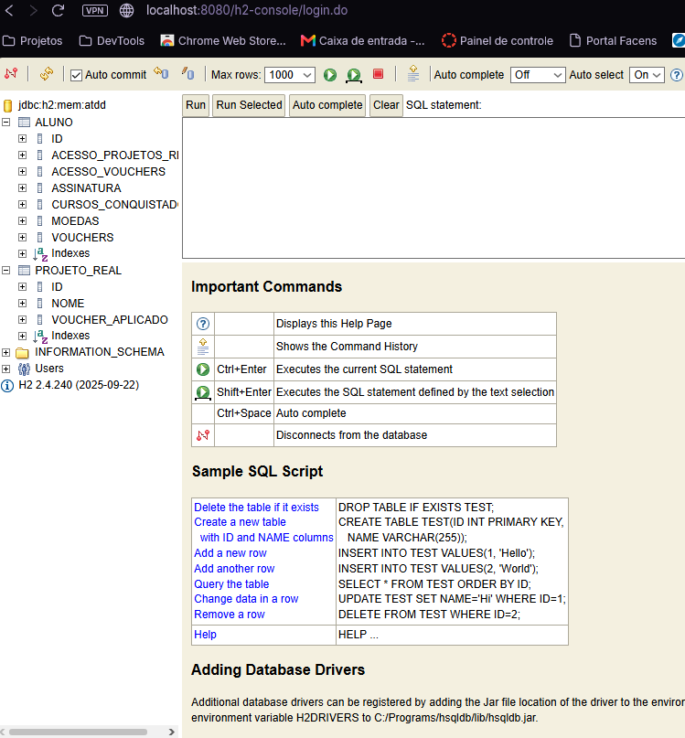
* Swagger rodando:<br><br>
  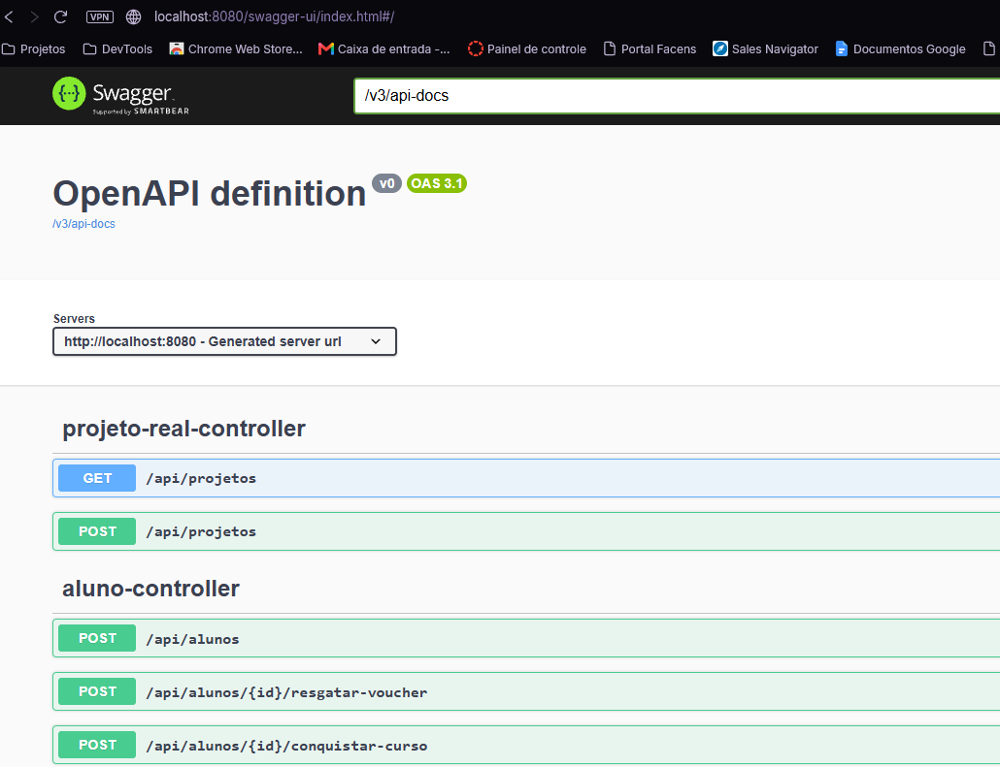
* PgAdmin rodando:<br><br>
  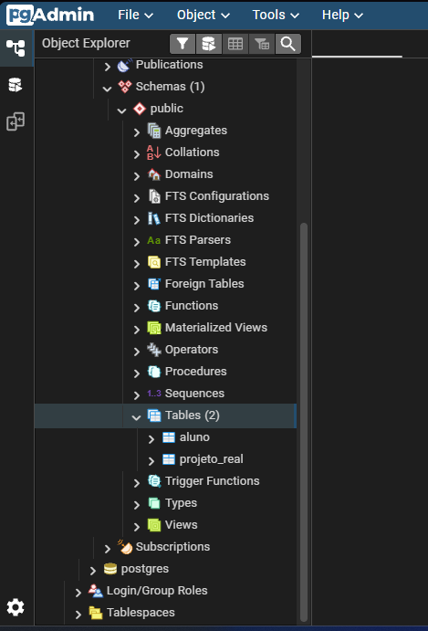
* Frontend:<br><br>
  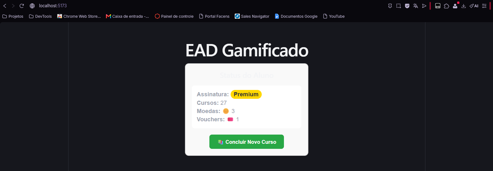

---

## B1: DESAFIO 1

## PROBLEMA

O MVP de gamificação evolui de aproximadamente 1.000 usuários para um cenário de até 100.000 usuários. Ranking,
cursos, conquistas e recompensas permanecem no Core, mas o Ranking tende a crescer mais que as demais
capacidades. A decisão arquitetural não deve partir da tecnologia desejada, e sim dos drivers que realmente
justificam mudança estrutural.

Organizei em três tabelas Markdown, mantendo o conteúdo original e corrigindo pequenos erros de escrita.

## RFs afetados

| ID   | Requisito funcional | Justificativa                                                                                                                                                                                                                                                              |
|------|---------------------|----------------------------------------------------------------------------------------------------------------------------------------------------------------------------------------------------------------------------------------------------------------------------|
| RF01 | Ranking             | A funcionalidade de ranking tende a receber um volume maior de acessos em relação às demais funcionalidades da aplicação. Portanto, necessita de escalabilidade funcional e arquitetônica.                                                                                 |
| RF02 | Conquistas          | As funcionalidades relacionadas a conquistas e outras recompensas tendem a evoluir juntamente com a gamificação da plataforma, necessitando de escalabilidade funcional e comunicação efetiva com o ranking, uma vez que a pontuação é proveniente dessas funcionalidades. |

### RNFs — Atributos de qualidade significativos (ASRs)

| Aprovação | ID    | Atributo de qualidade    | Justificativa                                                                                                                                                              |
|-----------|-------|--------------------------|----------------------------------------------------------------------------------------------------------------------------------------------------------------------------|
| ✅        | RNF01 | Manutenibilidade         | Como o sistema pretende crescer de forma geral, é importante que a arquitetura seja facilmente expansível, permitindo a adição de novas funcionalidades e regras.          |
| ✅        | RNF02 | Escalabilidade           | A previsão é que o ranking receba uma carga maior de usuários. Portanto, é importante que ele possa escalar horizontalmente quando necessário.                             |
| ✅        | RNF03 | Complexidade operacional | A equipe é reduzida e não possui experiência prévia com arquiteturas modulares ou microsserviços, o que aumenta a dificuldade de implementação e operação dessas soluções. |
| ❎        | RNF04 | Desempenho               | Não há evidências de deficiência de desempenho no cenário atual, embora esse atributo continue sendo relevante.                                                            |
| ❎        | RNF05 | Testabilidade            | É relevante, mas não deve se sobrepor às prioridades arquiteturais do cenário atual, no qual a testabilidade não está sendo prejudicada.                                   |

## RPCs — Restrições e premissas

| ID    | Restrição ou premissa                 | Descrição                                                                                                                               |
|-------|---------------------------------------|-----------------------------------------------------------------------------------------------------------------------------------------|
| RPC01 | Core atual em Java/Spring Boot        | O núcleo atual do projeto deve ser mantido para evitar retrabalho desnecessário.                                                        |
| RPC02 | Equipe de 3 desenvolvedores           | A equipe é reduzida e não possui experiência prévia com arquiteturas complexas, como microsserviços.                                    |
| RPC03 | Banco de dados relacional já modelado | O banco PostgreSQL já está modelado, e não há evidências que justifiquem sua substituição.                                              |
| RPC04 | Legado da AC1                         | O domínio existente deve ser preservado, evitando retrabalho e priorizando a evolução incremental, respeitando o princípio Open/Closed. |

## Alternativas e Trade-Offs

| Arquitetura         | Vantagens                                                                                                              | Desvantagens                                                                                                                  | Avaliação de implementação                                                                                                                                                 |
|---------------------|------------------------------------------------------------------------------------------------------------------------|-------------------------------------------------------------------------------------------------------------------------------|----------------------------------------------------------------------------------------------------------------------------------------------------------------------------|
| Monólito em Camadas | Baixíssima complexidade operacional; Não há necessida de alterar a arquitetura existente;                              | Risco de aumento de acoplamento, causando problemas de escalabilidade e testabilidade                                         | É possível manter, mas dado o cenário de escalabilidade, pode não ser interessante mantê-lo, além de dificultar uma futura possibilidade de implementação de microsserviço |
| Monólito Modular    | Diminui acoplamento, facilitando escalabilidade, testes e manutenção; Facilita uma futura migração para microsserviços | Os serviços ainda não são totalmente independentes; Complexidade de implementação baixa, mas existente, no contexto da equipe | Melhor possibilidade para o cenário atual, que pede escalabilidade individual, sem retrabalho excessivo                                                                    |
| Microsserviços      | Serviços totalmente independentes, facilitando deploy, testes, manutenção e escala                                     | Altíssimo custo e complexidade de operação e infraestrutura; Migração complexa exigindo muito retrabalho                      | Para o cenário atual, não há necessidade da implementação do mesmo, que levaria ao overengineering                                                                         |

## Decisão do Tech Lead

> Dadas as necessidades expostas, de escalabilidade funcional, mas não de desempenho; E dadas as limitações técnicas da
> equipe, que envolvem limitações de custo operacional e habilidades; Optou-se por seguir com a implementação da
> arquitetura **monolítica modular**, evoluindo a arquitetura monolítica em camadas. A arquitetura monolítica modular
> apresenta a menor complexidade operacional e melhor atende as necessidades do cenário apresentado. Essa evolução mantém
> o core em Spring Boot, separando as funcionalidades em módulos, possibilitando escalar as funcionalidades necessárias
> sem a necessidade ratrabalho, e com o menor custo operacional e de infraestrutura. A implementação de microsserviços só
> virá a ser cogitada quando houver uma necessidade real de escalabilidade horizontal de uma determinada funcionalidade.
